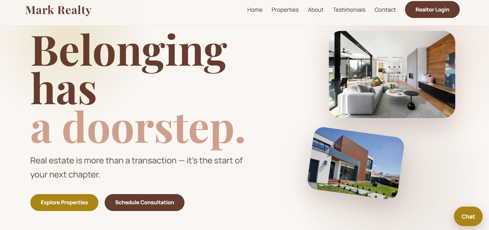
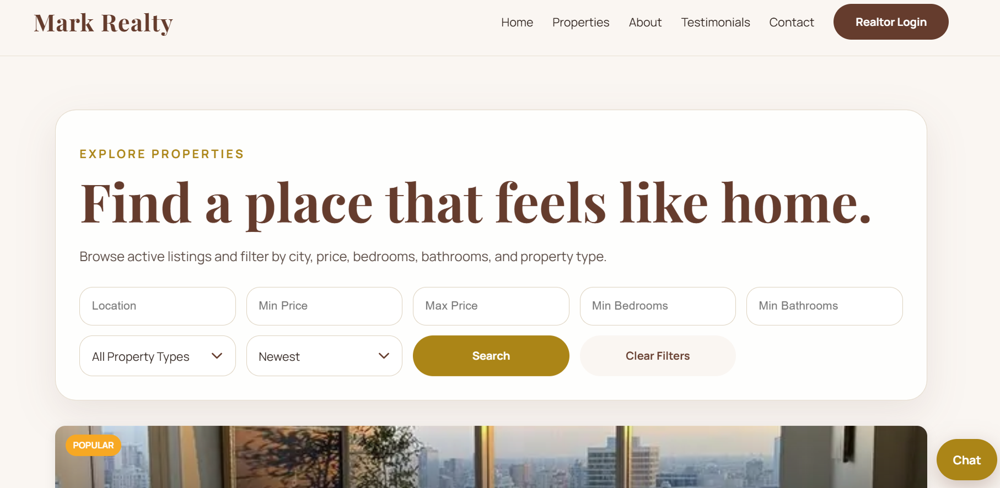
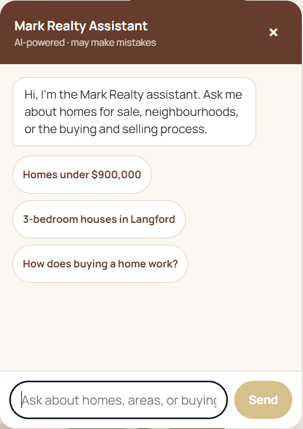
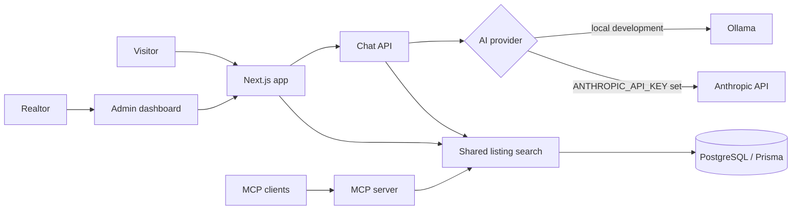

# Mark Realty


A full-stack real estate platform for an independent realtor. Visitors browse and filter listings and send inquiries, the realtor manages everything from a private dashboard, and an **AI assistant** answers questions by searching the live listing database. The same data is exposed to other AI tools through a read-only **Model Context Protocol (MCP)** server.

**Live demo:** [markrealty.vercel.app](https://markrealty.vercel.app)

> Listings, photos and testimonials in the demo are sample content.

| Home | Listings |
|---|---|
|  |  |

| AI assistant |
|---|
|  |

## Highlights

- **Grounded AI assistant.** The model answers listing questions only through a `search_listings` tool backed by the database, so it cannot invent properties. Works with the Anthropic API in production or a local Ollama model for free development.
- **MCP server.** The same listing search is available over stdio and an authenticated HTTP endpoint, returning public fields only.
- **Secure by default.** Signed, HTTP-only admin sessions, every admin API route protected, Zod validation on all inputs, and rate limiting on public endpoints.
- **Engineering hygiene.** TypeScript strict mode, a test suite, and GitHub Actions CI (type check, tests, production build against a Postgres service) on every pull request.

## Features

**Public site**
- Homepage with featured listings and testimonials
- Listings with filters (location, price, bedrooms, bathrooms, property type) and sorting
- Property pages with photo gallery, map and mortgage calculator
- Inquiry form on every listing, saved as leads
- Newsletter signup: subscribers are emailed when a new listing is published
- Testimonials submitted by visitors and shown after approval
- AI chat assistant on every page
- Responsive layout, sitemap and `robots.txt`

**Admin dashboard** (password protected)
- Create, edit, delete, suspend and reactivate listings, with Cloudinary image uploads
- Review inquiries and subscribers
- Approve or delete testimonials

## Architecture



The website, the chat assistant and the MCP server all read listings through one shared query in `src/lib/listings.ts`. That keeps the rules for what counts as public (for example, suspended listings are hidden) in a single place.

## AI chat assistant

A floating chat button on every public page opens an assistant that can answer real estate questions and search listings ("3-bedroom houses in Langford under $900k"). Matching listings appear as cards that link to the property page. A **New chat** button clears the conversation and is disabled while a reply is loading.

- The model calls a `search_listings` tool and results come from the database.
- Only public listing fields are shared with the model.
- Requests are validated, size-limited and rate limited per IP.
- Tool output is treated as data, not instructions.
- Small local models are guided by simple intent checks: a listing search only runs when the message looks like a home search, and a leaked tool call is retried as a plain answer.

Two providers are supported and chosen automatically:

| Provider | When it is used | Setup |
|---|---|---|
| **Anthropic API** | `ANTHROPIC_API_KEY` is set (recommended for production) | Add the key to your environment and set a monthly spend limit in the Anthropic console. |
| **Ollama** | No API key, outside production (free local development) | Install [Ollama](https://ollama.com), run `ollama pull llama3.2:3b`, then set `OLLAMA_MODEL="llama3.2:3b"`. The 1B default is fast but gives weaker answers. |

If neither is available, the chat button still loads and says the assistant is unavailable.

## MCP server

A read-only [Model Context Protocol](https://modelcontextprotocol.io) server exposes two tools, `search_listings` and `get_listing`. It returns public listing data only: no inquiries, subscribers or admin actions.

- **Local (stdio):** `npm run mcp`, then add it to an MCP client such as Claude Desktop.
- **HTTP:** `POST /api/mcp` with `Authorization: Bearer <MCP_API_TOKEN>`. The endpoint returns `503` if no token is configured and `401` for a missing or wrong token.

## Tech stack

| Layer | Choice |
|---|---|
| Framework | Next.js 16 (App Router, Server Components), React 19 |
| Language | TypeScript (strict) |
| Database | PostgreSQL with Prisma |
| Auth | Signed JWT in an HTTP-only cookie (jose) |
| AI | Anthropic API or Ollama, MCP SDK |
| Images / email | Cloudinary / Resend |
| Validation | Zod |
| Local infrastructure | Docker Compose (Postgres + pgAdmin) |
| CI / hosting | GitHub Actions / Vercel |

## Getting started

**Prerequisites:** Node.js 20+, Docker Desktop (or OrbStack)

```bash
git clone https://github.com/TaqdeerK22/realtor-site.git
cd realtor-site
cp .env.example .env     # then edit it, see below
docker compose up -d     # local Postgres
npm install
npm run db:push          # create the tables
npm run db:seed          # sample listings and testimonials (local database only)
npm run dev
```

Open http://localhost:3000. The admin dashboard is at `/login`.

### Environment variables

Copy `.env.example` to `.env`. Required to run:

| Variable | Purpose |
|---|---|
| `DATABASE_URL` | Postgres connection string (matches `docker-compose.yml` by default) |
| `ADMIN_PASSWORD` | Password for the `/login` admin dashboard |
| `AUTH_SECRET` | Random string of **32+ characters** used to sign admin sessions |

Optional features:

| Variable | Purpose |
|---|---|
| `ANTHROPIC_API_KEY`, `ANTHROPIC_MODEL` | AI assistant in production |
| `OLLAMA_URL`, `OLLAMA_MODEL` | AI assistant in local development |
| `MCP_API_TOKEN` | Bearer token for the `/api/mcp` endpoint |
| `RESEND_API_KEY`, `FROM_EMAIL` | New-listing emails to subscribers |
| `NEXT_PUBLIC_CLOUDINARY_CLOUD_NAME`, `NEXT_PUBLIC_CLOUDINARY_UPLOAD_PRESET` | Listing image uploads |
| `NEXT_PUBLIC_SITE_URL` | SEO metadata, sitemap and shareable links |

Generate secrets with:

```bash
node -e "console.log(require('crypto').randomBytes(48).toString('base64url'))"
```

### Scripts

| Command | What it does |
|---|---|
| `npm run dev` | Start the dev server |
| `npm run build` / `npm start` | Production build / server |
| `npm run typecheck` | TypeScript check |
| `npm test` | Run the test suite |
| `npm run db:push` / `npm run db:seed` | Create tables / load sample data |
| `npm run mcp` | Start the local MCP server |

pgAdmin runs at http://localhost:5050 (credentials are in `docker-compose.yml`, for local use only).

## Deploying to Vercel

The live site does not depend on your own machine, but it needs its own hosted services:

1. **Database:** create a hosted Postgres (for example Neon), then create the tables once from your machine:
   ```bash
   DATABASE_URL="<hosted connection string>" npx prisma db push
   ```
   The seed script refuses non-local databases on purpose, so add live listings through the admin dashboard.
2. **Vercel:** import the repository and add the environment variables above (at least `DATABASE_URL`, `ADMIN_PASSWORD` and `AUTH_SECRET`). Variables only apply to new deployments, so redeploy after changing them.
3. **AI assistant:** set `ANTHROPIC_API_KEY` for the live assistant. Without it the chat reports that it is unavailable. Do not set `OLLAMA_URL` to `127.0.0.1` in production.
4. Every merge to `main` deploys automatically.

## Security

- Every admin API route requires a valid session, and dashboard pages are protected by middleware as well.
- Sessions are signed with `AUTH_SECRET` (32+ characters required), HTTP-only, and `Secure` in production.
- Login, inquiry, newsletter, testimonial and chat endpoints are rate limited.
- All request bodies are validated with Zod. Listing images must come from allowed hosts or local paths.
- Suspended listings are hidden from the public site, the API, the chatbot and MCP.
- Secrets live in `.env`, which is git-ignored. Docker services only listen on localhost.

**Known limitation:** the rate limiter is in-memory, so limits are per server instance. For strict limits on serverless hosting it should move to a shared store such as Upstash Redis (see the roadmap).

## Testing and CI

`npm test` covers authentication, rate limiting, validation and the chatbot's tool-calling flow, using a mocked AI provider so tests are fast and deterministic. GitHub Actions runs schema validation, a type check, the tests and a production build against a Postgres service on every push and pull request. Dependabot keeps dependencies and workflow actions up to date.

## Project structure

```
src/
  app/            Routes: public pages, /dashboard, /api
  components/     UI components, including the chat widget
  lib/            Auth, validation, rate limiting, listing search, chat logic
mcp/              MCP server and tools (shared with /api/mcp)
prisma/           Schema and seed data
tests/            Unit tests
docs/             README screenshots
```

## Roadmap

**Shipped**
- [x] Public listings with filters, galleries, map and mortgage calculator
- [x] Admin dashboard with session auth and image uploads
- [x] AI assistant with database-backed listing search
- [x] Read-only MCP server (stdio and authenticated HTTP)
- [x] CI with type check, tests and build on every pull request

**Next**
- [ ] Email inquiries to the realtor as they arrive
- [ ] Shared rate limiting (Upstash Redis) so limits hold on serverless
- [ ] End-to-end tests for the inquiry and admin flows
- [ ] Branding config (name, colours, logo) so the template can be reused

## License

MIT. See [LICENSE](LICENSE).
